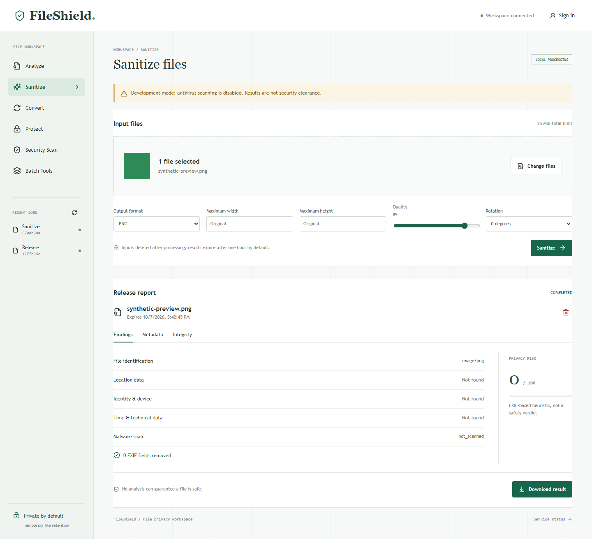
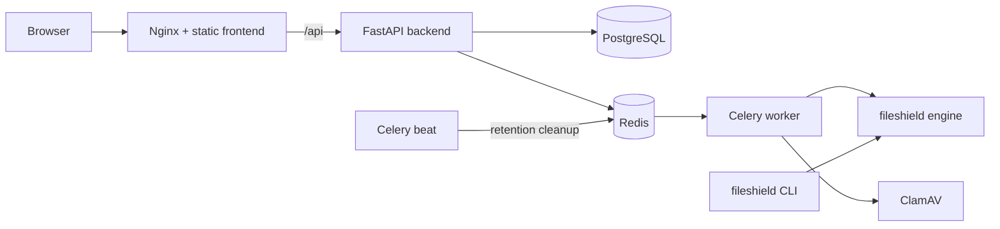

# FileShield

FileShield is a self-hosted workspace for file privacy. It identifies files, reports privacy risks in their metadata, creates sanitized copies, verifies integrity with cryptographic hashes, and encrypts files with authenticated encryption.

It comes with a command-line tool, a FastAPI backend that processes jobs asynchronously, and a React web interface.

> **Status:** FileShield has a working, tested development baseline. It is not a certified production service. Before accepting untrusted public uploads, read [Limitations](docs/limitations.md) and the [Release checklist](docs/release-checklist.md).



## Contents

- [Features](#features)
- [Architecture](#architecture)
- [Requirements](#requirements)
- [Getting started](#getting-started)
- [Command-line usage](#command-line-usage)
- [HTTP API](#http-api)
- [Configuration](#configuration)
- [Docker deployment](#docker-deployment)
- [Testing and verification](#testing-and-verification)
- [Project layout](#project-layout)
- [Documentation](#documentation)

## Features

| Area | Capabilities |
| --- | --- |
| Identification | Checks file signatures against the reported MIME type, flags extension mismatches, and reports basic file information |
| Integrity | SHA-256 and SHA-512 hashing, plus hash comparison between files |
| Metadata | Extracts image EXIF data, sorts fields into high (GPS), medium (device, author, software), and low (timestamps, dimensions) sensitivity, and gives each file a privacy risk score from 0 to 100 |
| Sanitization | Re-encodes JPEG, PNG, WebP, and TIFF images from fresh pixel data; converts between formats; supports bounded resize, crop, rotation, quality, and DPI settings; packages batch output as a ZIP file |
| PDF | Rewrites metadata conservatively; merges, extracts, reorders, and rotates pages. Refuses to rewrite PDFs that contain active content, annotations, embedded files, forms, or signatures |
| Archives | Inspects ZIP, TAR, and GZIP archives without extracting them |
| Protection | Encrypts and decrypts files using Scrypt key derivation and AES-256-GCM containers |
| Scanning | Includes a ClamAV INSTREAM adapter; scanning is required by default |
| Web workspace | Uploads files, shows analysis and risk scores, downloads results, keeps job history, and supports both accounts and anonymous sessions |
| Service hardening | Versioned API, job ownership checks, upload size limits, server-generated storage paths, automatic retention cleanup, rate limiting, and security headers |

## Architecture



- `fileshield/` is the processing engine, which the CLI and the backend share.
- `backend/` is the FastAPI service, including authentication, job storage, and the Celery workers.
- `frontend/` is the React and TypeScript web workspace, built with Vite.

For details, see [Architecture](docs/architecture.md).

## Requirements

- Python 3.12 or newer
- Node.js 24 LTS (only needed for the frontend)
- Docker with Compose v2 (optional, for the full stack)

## Getting started

### Linux and macOS

```bash
python3.12 -m venv .venv
.venv/bin/python -m pip install --upgrade pip
.venv/bin/python -m pip install -r requirements-dev.txt
.venv/bin/python -m pip install --no-deps -e .
npm --prefix frontend ci
.venv/bin/python -m pytest -q
```

Start the API on the loopback interface. The commands below turn off antivirus scanning, so only use non-sensitive test files:

```bash
export FILESHIELD_ENV=development
export FILESHIELD_SECRET_KEY="$(python3 -c 'import secrets; print(secrets.token_hex(32))')"
export REQUIRE_SCAN=false
export PUBLIC_ORIGIN=http://localhost:5173
.venv/bin/python -m uvicorn backend.app:app --host 127.0.0.1 --port 8000 --no-access-log
```

In a second terminal, start the frontend:

```bash
npm --prefix frontend run dev -- --port 5173
```

### Windows (PowerShell)

```powershell
py -3.12 -m venv .venv
& ./.venv/Scripts/python.exe -m pip install --upgrade pip
& ./.venv/Scripts/python.exe -m pip install -r requirements-dev.txt
& ./.venv/Scripts/python.exe -m pip install --no-deps -e .
npm --prefix frontend ci
./scripts/start-dev.ps1
```

Then, in a second terminal:

```powershell
npm --prefix frontend run dev -- --port 5173
```

Open <http://localhost:5173> to use the workspace. The OpenAPI schema is served at <http://127.0.0.1:8000/openapi.json>.

> The development server is not a sandbox. Don't expose it on a public network. If you don't set a secret key, `start-dev.ps1` generates a temporary one, and jobs created under a previous key can't be resumed.

## Command-line usage

Installing the package adds a `fileshield` command. You can also run `python fileshield_cli.py` directly.

```bash
fileshield info photo.jpg                     # type, size, signature evidence
fileshield hash photo.jpg --json              # SHA-256 and SHA-512
fileshield hash photo.jpg -a sha256           # selected algorithms
fileshield metadata photo.jpg                 # EXIF findings and privacy classification
fileshield analyze photo.jpg                  # combined analysis
fileshield sanitize photo.jpg                 # writes photo.cleaned.png
fileshield sanitize photo.jpg --format jpeg --output clean.jpg
fileshield archives bundle.zip                # inspect without extracting
fileshield protect report.pdf --output report.fshield
fileshield decrypt report.fshield --output report.pdf
```

- Output files are created exclusively, so existing files, including the original, are never overwritten.
- `protect` and `decrypt` prompt for the password. It is never passed as a command-line argument.
- The CLI does not scan or sandbox its input. Only process files you trust, or run it in an isolated environment.

## HTTP API

All endpoints are under `/api/v1`. Processing runs as asynchronous jobs that belong to the session that created them.

| Method | Path | Purpose |
| --- | --- | --- |
| `GET` | `/health` | Liveness check |
| `POST` | `/session` | Start an anonymous session |
| `POST` | `/auth/register`, `/auth/login`, `/auth/logout` | Account management |
| `POST` | `/jobs/{operation}` | Submit a job (multipart `files` + `options`) |
| `GET` | `/jobs`, `/jobs/{id}` | List jobs or get the status of one job |
| `GET` / `DELETE` | `/files/{id}` | Download or delete a job's output |

Supported operations: `analyze`, `metadata`, `sanitize`, `hash`, `compare`, `scan`, `images`, `batch`, `pdf`, `archives`, `protect`, `decrypt`, `release`.

For request and response schemas, limits, and error codes, see [API](docs/api.md).

## Configuration

The backend reads its settings from environment variables. [.env.example](.env.example) has a template without secrets.

| Variable | Default | Description |
| --- | --- | --- |
| `FILESHIELD_ENV` | `development` | Set to `production` to enforce strict settings |
| `FILESHIELD_SECRET_KEY` | none | Required. 32 random bytes as 64 hex characters, used to encrypt stored job parameters |
| `DATABASE_URL` | `sqlite:///./temp/fileshield.db` | SQLAlchemy database URL. Must use PostgreSQL in production |
| `REDIS_URL` | empty | Celery broker URL. If empty, jobs run in-process. Required in production |
| `STORAGE_ROOT` | `./temp/jobs` | Job file storage directory |
| `PUBLIC_ORIGIN` | `http://localhost:5173` | Allowed browser origin |
| `REQUIRE_SCAN` | `true` | Reject files that ClamAV has not scanned |
| `CLAMAV_HOST` | `clamav` | ClamAV daemon host |
| `RETENTION_SECONDS` | `3600` | Time before job files are deleted |
| `MAX_PROCESS_TIME` | `60` | Time limit for each processing step, in seconds |

## Docker deployment

The Compose stack runs Nginx with the frontend, the API, a Celery worker and scheduler, PostgreSQL, Redis, and ClamAV. Application containers run as a non-root user with read-only filesystems, all capabilities dropped, and resource limits. Only the frontend is published, on `127.0.0.1:8080`.

```bash
cp .env.example .env
# set FILESHIELD_SECRET_KEY and POSTGRES_PASSWORD in .env
docker compose config --quiet
docker compose up --build
```

To initialize a new database, use [scripts/init-db.py](scripts/init-db.py). Before you put the stack behind a public endpoint, review [Deployment](docs/deployment.md) for TLS, secrets, and the remaining verification steps.

## Testing and verification

```bash
.venv/bin/python -m pytest -q                       # unit, API, security and integration tests
.venv/bin/python -m pip_audit -r requirements.txt   # Python dependency audit
npm --prefix frontend run build                     # type-check and build
npm --prefix frontend audit --audit-level=high      # frontend dependency audit
npx --prefix frontend playwright install chromium
npm --prefix frontend run test:browser              # end-to-end browser test
```

On Windows, [scripts/check-security.ps1](scripts/check-security.ps1) runs the tests, audits, and build together.

The browser test uploads a synthetic PNG. It then runs analysis, sanitization, download, and deletion, and checks the layout at widths of 1440, 390, and 320 pixels. Screenshots are saved as [desktop](docs/workspace-desktop.png) and [mobile](docs/workspace-mobile.png). GitHub Actions in `.github/workflows` run pytest, the dependency audits, the frontend build, and Compose validation.

Passing tests, a zero risk score, or a clean antivirus result do not prove that a file is safe. For the scope of the current checks, see [Limitations](docs/limitations.md).

## Project layout

```text
backend/        FastAPI app, auth, storage, Celery workers
fileshield/     Processing engine and CLI
frontend/       React + TypeScript web workspace
docker/         Backend, frontend and Nginx container definitions
docs/           Design, security and operations documentation
scripts/        Development, database and verification helpers
tests/          pytest suite (unit, api, security, integration, ...)
```

## Documentation

- **Design:** [Architecture](docs/architecture.md), [API](docs/api.md), [File types](docs/file-types.md), [Scoring](docs/scoring.md)
- **Processing:** [Metadata](docs/metadata.md), [Sanitization](docs/sanitization.md), [Hashing](docs/hashing.md), [Archives](docs/archives.md), [PDF](docs/pdf.md), [Protection](docs/protection.md)
- **Security:** [Threat model](docs/threat-model.md), [Security controls](docs/security.md), [Privacy](docs/privacy.md)
- **Operations:** [Deployment](docs/deployment.md), [Performance](docs/performance.md), [Dependency policy](docs/dependencies.md), [Accessibility](docs/accessibility.md), [Release checklist](docs/release-checklist.md), [Limitations](docs/limitations.md)


## Author

**Manav Gupta**

CyberSecurity Student | Software Developer | Backend Engineer