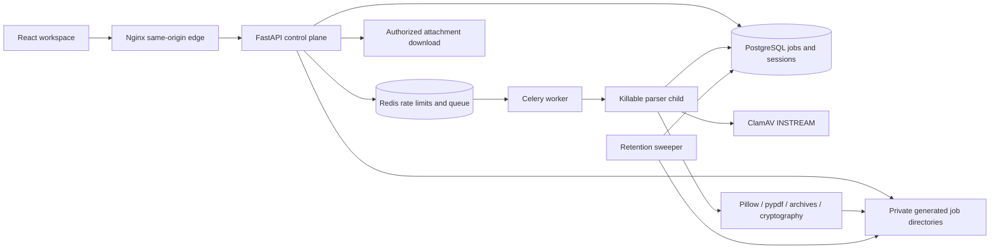

# Architecture

API code stores opaque uploads and schemas but never calls image/PDF parsers during request handling. Generated UUID directories contain `input-{index}.bin` and fixed server-chosen output names. Filenames and declared MIME are display/comparison values only.

API -> queue -> worker transitions are persisted in SQL. Workers atomically claim only queued, unexpired jobs. Each task runs a fresh Python child with a timeout. POSIX adds CPU/address-space/file-size/descriptor limits. Compose constrains the worker container separately. Development uses SQLite and FastAPI background tasks with the same child process; it is not a distributed queue or sandbox.

Scanner-required processing rejects infected/unavailable responses before analysis and scans bounded outputs before releasing them. A successful result stores a bounded report and output hashes; inputs are deleted. Expiration denies access immediately and a sweeper deletes expired data asynchronously.

Trust boundary limitation: parser children currently inherit worker environment credentials and share the jobs volume. A compromised parser can access those credentials, other jobs, and internal services. This is process fault containment, not strong hostile-parser isolation. Public production requires a credential-free, per-job mount/network sandbox and a narrow result channel.

The queue/database/filesystem update is not one atomic transaction. Orphan recovery, reconciliation, durable Redis configuration and migration management are release work. Current Redis configuration is deliberately ephemeral for local Compose trials; do not use it as a production durability claim.